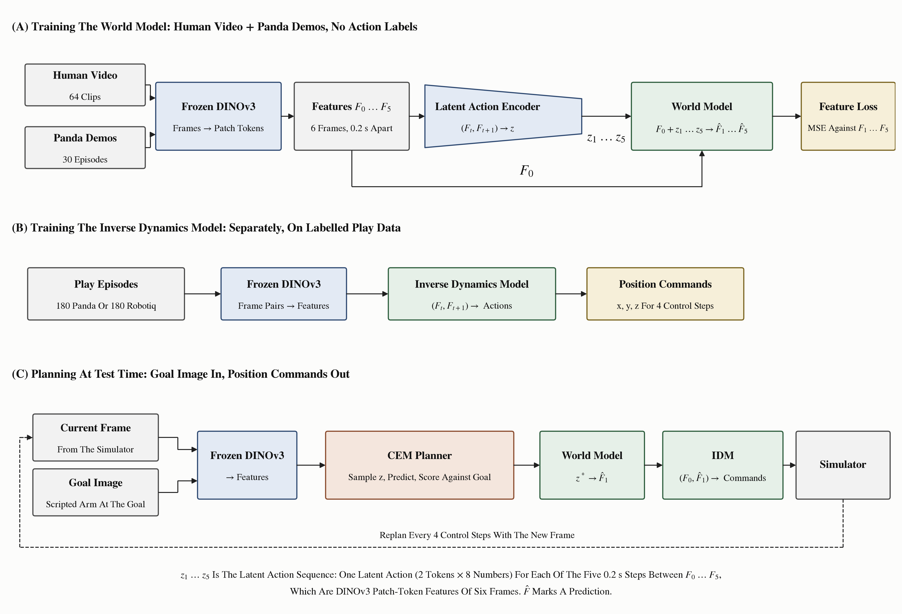
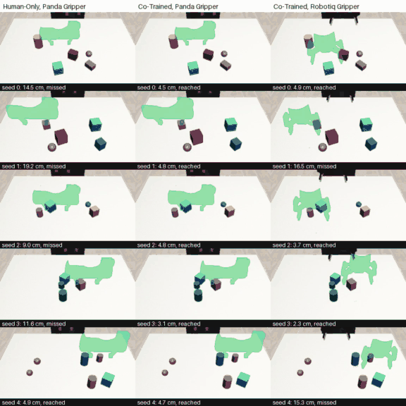
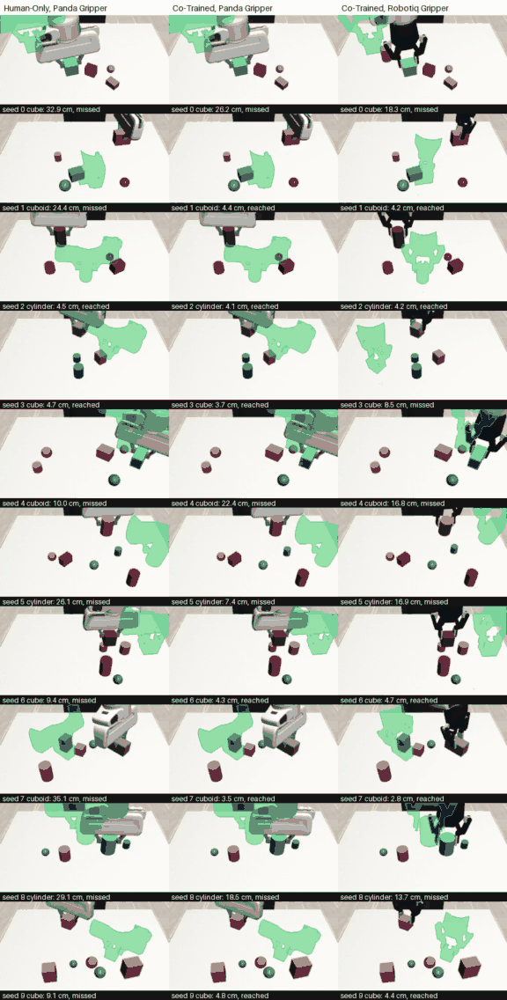
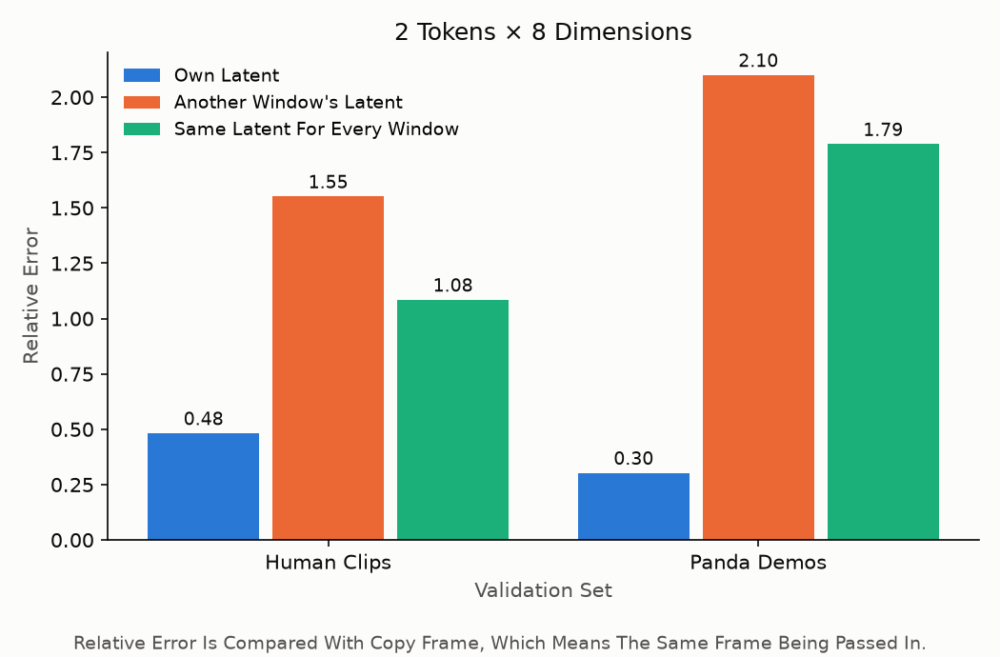
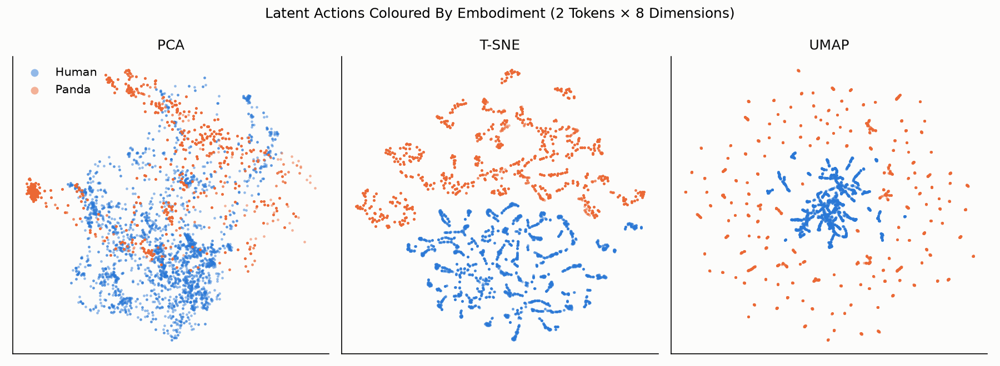
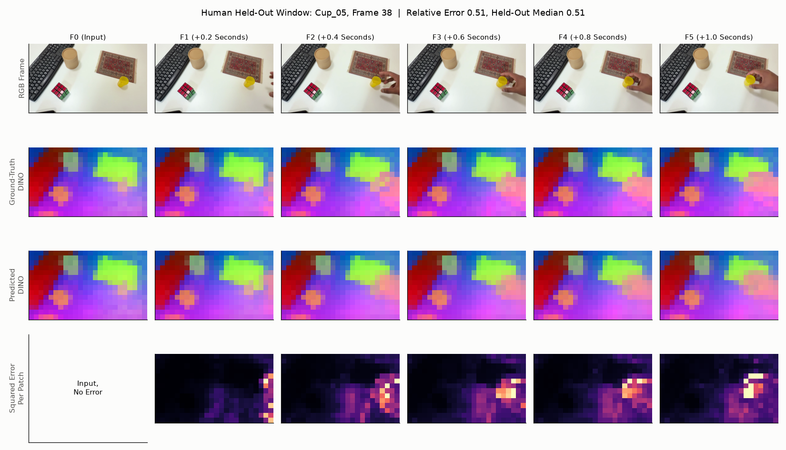
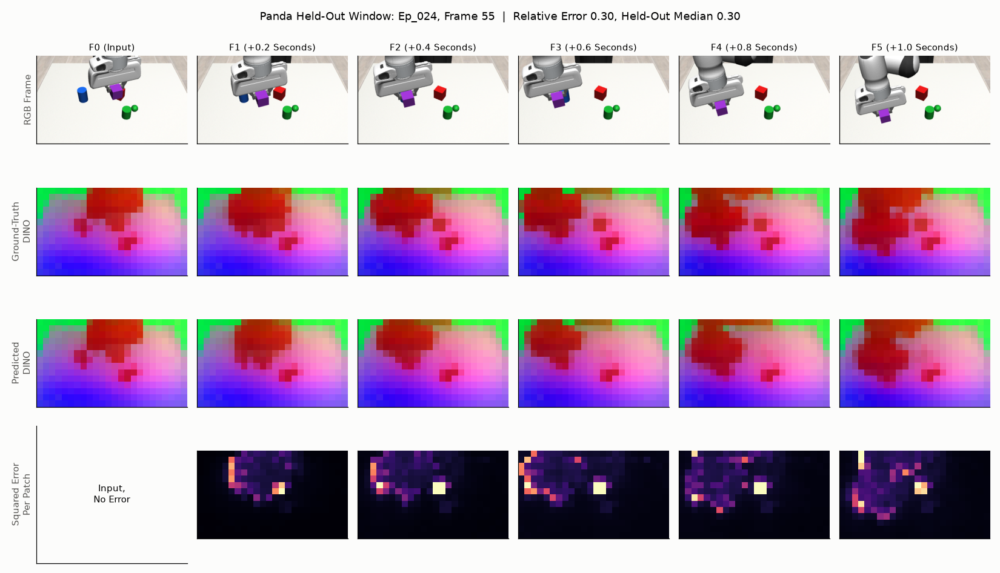

# Latent Action World Model From Human Video, Planned In Simulation


**Explainer video (106 s).** Full quality: [docs/videos/explainer.mp4](docs/videos/explainer.mp4). The bullets below say the same thing in words.

A world model learns, from egocentric phone video I recorded and 30 simulated Panda demonstrations, to predict future visual features from a
low-dimensional latent action. A separately trained inverse dynamics model (IDM) turns a planned latent action into end-effector
commands, so the robot moves toward a goal image. Scope: controlled end-effector motion in simulation (reaching and carrying a
held object). The gripper is not controlled.

**Notation, used in every figure and in the video.** $F_t$ is the **latent state**: the frozen DINOv3 patch tokens of frame $t$ (14 × 24 tokens × 384).
$z_t$ is the **latent action**: the 2 × 8 code the encoder infers from the pair $(F_{t-1}, F_t)$, i.e. what changed between them. $\hat{F}_t$ is the world model's prediction of $F_t$.

- **Human data.** 64 egocentric phone clips of one hand moving cards, a cube, a cup, a cylinder or a duster; 8 clips include a drop. No robot, no action labels.
- **Robot data.** 30 scripted Panda demonstrations in simulation: random start and goal positions, random objects (cube, cuboid, cylinder) and clutter. 9 of the 30 are deliberately imperfect (released mid-carry, edge grasps, missed grasps), so the model also sees unstable grasps.
- **Latent state.** Frozen DINOv3 patch tokens (14 × 24 tokens × 384) of six frames 0.2 s apart, shown with PCA colours.
- **Latent action.** A self-attention encoder reads each pair of consecutive frames and squeezes the change into a 2 × 8 bottleneck: one latent action per pair, five per window.
- **World model.** A causal latent action decoder predicts F̂₁ … F̂₅ from F₀ and z₁ … z₅. F̂ₖ attends to z₁ … zₖ only, so one forward pass predicts a second ahead for planning. Half of every training batch is human, half is robot; the only loss is MSE against the true tokens.
- **Inverse dynamics model.** Trained separately on 180 labelled play episodes to map two frames to a robot action. The world model never sees these labels; they only turn predicted frames into commands. A second IDM trained on Robotiq play data drives the Robotiq gripper with the same world model.
- **Planning.** CEM over latent actions scores predicted frames against a goal image; the IDM turns the best prediction into commands; replan every 0.2 s.
- **Results.** Fixed-seed reach (5) and carry (10) tasks per condition; success is the end effector within 5 cm of the goal pose. Co-trained + Panda 5/5 and 6/10, co-trained + Robotiq 3/5 and 5/10, human-only 1/5 and 2/10.

## Data

Both datasets I collected are on Hugging Face: **[VinayMohan/latent-action-world-model-data](https://huggingface.co/datasets/VinayMohan/latent-action-world-model-data)**
(`human_videos/`: 64 egocentric clips; `panda_demos/`: 30 simulated episodes as HDF5 plus videos). Download them straight into the layout the code expects:

```
hf download VinayMohan/latent-action-world-model-data --repo-type dataset --local-dir data
```

The 200-episode play sets used only by the IDM are regenerated with `src.sim.play` (commands under Run).

## Pipeline



The world model never sees an action label. The IDM is the only part trained on labelled actions, and it is trained separately.

## Experimental Protocol

### Data

| Data | What it is | Size | Used for |
|---|---|---|---|
| Human videos | Egocentric phone clips of a hand moving cards, cubes, cups, cylinders and dusters (8 with a drop) | 64 clips, 14 held out for validation | World model |
| Panda demos | Scripted pick-and-place of a cube, cuboid or cylinder among clutter, incl. mid-carry releases, edge grasps and missed grasps | 30 episodes, 6 held out | Co-training |
| Panda play | Random waypoints and gripper toggles among clutter, with action labels | 200 episodes, 20 held out | Panda IDM; planner's latent prior |
| Robotiq play | Same recipe with a Robotiq 85 gripper on the Panda arm | 200 episodes, 20 held out | Robotiq IDM |

Frames are resized to 224 × 384. Human frames are 12 apart at 60 fps and simulated frames 4 control steps apart, both 0.2 s.
Simulated objects use 6 training colours; 4 further colours are held out for evaluation.

### Models

| Model | World model trained on | IDM trained on (labelled actions) |
|---|---|---|
| Human-only | All 64 human clips, 10 epochs, no robot frames | 180 Panda play episodes |
| Co-trained (main) | 50 human clips + 24 Panda demos (the rest held out), 20 epochs, half a batch from each domain per step | 180 Panda play episodes (Panda gripper); 180 Robotiq play episodes (Robotiq gripper) |

Each IDM predicts the 3 position commands over 4 control steps from a pair of frame features, trained for 30 epochs and kept at its best
held-out play error. It has no gripper output.

### What Was Seen And Unseen

| | Seen in training | Unseen at test |
|---|---|---|
| Human-only | Human hands and objects | The robot, the simulator, every test scene |
| Co-trained, Panda | Panda arm and gripper, table scenes, pick-and-place arm motions, cube / cuboid / cylinder | Object colours, clutter layouts, goal poses |
| Co-trained, Robotiq | The same, plus Robotiq play data for its IDM only | The Robotiq gripper in the world model (never trained on its frames), plus the above |

Pick-and-place motions appear in the demos, so these are not claims about unseen tasks.

### What Was Tested

Three conditions (human-only + Panda, co-trained + Panda, co-trained + Robotiq) each ran the same fixed-seed tasks. The planner is
given only a goal image, rendered by a scripted arm moving 15-25 cm from the start. A task counts as a success if the end effector gets within
**5 cm (3D)** of the goal pose; the budget is 75 replans (300 control steps, 15 s).

- **Reach** (5 tasks): open gripper, goals spread over the forward half-plane in five direction bins, each fully in view.
- **Carry** (10 tasks): the gripper starts holding a cube, cuboid or cylinder (cycling by seed, unseen colours) lifted off the table and moves it to a random goal pose;
  the gripper stays closed because no IDM predicts it.

Planner: CEM over latent actions (256 samples, 32 elites, 4 iterations), goal features weighted toward the patches that change between start and goal,
latent prior fitted to Panda play latents. Goal poses are rendered with each condition's own gripper, so they differ slightly between conditions.

## Results

### Task Success

| Condition | Task | Success | Mean Start Distance | Mean End Distance |
|---|---|---|---|---|
| Human-Only, Panda Gripper | Reach | 1 / 5 | 19.8 cm | 11.8 cm |
| Human-Only, Panda Gripper | Carry | 2 / 10 | 18.7 cm | 18.5 cm |
| Co-Trained, Panda Gripper | Reach | 5 / 5 | 19.8 cm | 4.4 cm |
| Co-Trained, Panda Gripper | Carry | 6 / 10 | 18.7 cm | 9.9 cm |
| Co-Trained, Robotiq Gripper | Reach | 3 / 5 | 21.9 cm | 8.5 cm |
| Co-Trained, Robotiq Gripper | Carry | 5 / 10 | 19.0 cm | 9.4 cm |

Doing nothing leaves the end effector at its start distance, so human-only barely improves on that while co-training roughly halves it.
Human-only has no robot data in its world model, which is the likely cause. The co-trained model also moves the Robotiq arm toward the goal
even though its world model never saw that gripper; only the Robotiq IDM did.

Reach (5 tasks, a column per condition; green is the goal gripper pose) - [full-quality video](docs/videos/reach_examples.mp4):



Carry (10 tasks; the carried object cycles cube, cuboid, cylinder) - [full-quality video](docs/videos/carry_examples.mp4):



The current main limit is depth. In several misses the gripper overlaps its green goal silhouette in the image while the 3D distance is still 9-15 cm,
so the model gets near the goal in the image but struggles to place the gripper at the right depth from one front camera. We have not measured the error per axis, so
this is a hypothesis.

### The Latent Action Matters

Relative error is the world model's squared error divided by that of copy frame (the same frame being passed in), averaged over the 5 predicted frames; below 1 beats copying.
Three latents are fed to the world model on held-out windows: the window's own, another window's, and one constant latent (the training mean) for every window.

| Validation set | Own latent | Another window's latent | Same latent for every window |
|---|---|---|---|
| Human clips | 0.48 | 1.55 | 1.08 |
| Panda demos | 0.30 | 2.10 | 1.79 |

Only the window's own latent beats copying, so the world model reads the latent action rather than ignoring it.



### Latent Space

PCA, t-SNE and UMAP of the latent actions of 600 held-out windows per embodiment, coloured by embodiment. Human and Panda latents occupy largely separate
regions in t-SNE and UMAP and overlap only partly in PCA. UMAP distances are density-driven, so read only the separation.



This is consistent with the latents encoding embodiment, although the human and Panda motion distributions also differ, so a paired test would be needed to separate the two.
Halving the bottleneck to 2 tokens x 4 numbers (`ablations/latent_2x4/`) costs a little accuracy (held-out relative error 0.53 human / 0.33 Panda against 0.48 / 0.30)
and clusters the same way, so capacity alone does not remove it. We kept 2 x 8.

### Predictions

One typical held-out window each, human then Panda. Rows: RGB frames; the true latent states $F_0 \dots F_5$ (DINOv3 tokens, PCA colours);
the world model's predictions $\hat{F}_1 \dots \hat{F}_5$ from $F_0$ and $z_1 \dots z_5$; and the per-patch squared error. The error sits on the moving hand or gripper:




Train-split examples: `docs/figures/prediction_examples/`.

### Inverse Dynamics Model (Panda Play Data)

Position MSE on held-out episodes against predicting the mean action: play 0.204 (baseline 0.519), demos 0.138 (baseline 0.221).

## Limitations

- **Depth.** One front camera; the gripper can look aligned with the goal in the image yet be several centimetres off in depth.
- **Small evaluation.** 5 reach and 10 carry tasks per condition, one trained model each, one training seed. One task changes a rate by 10-20 points.
- **Embodiment-specific latents.** See Latent Space: the latent is not embodiment-agnostic, which can limit transfer between embodiments.
- **No gripper control.** The gripper is held open (reach) or closed (carry); only the end effector's position is planned.
- **Correlation, not causation.** The world model's predictions are learned correlations between frames, not a causal model of what the robot did. Like the latent actions, it represents the whole scene transition (hand or arm, objects, shadows) rather than the embodiment's own action.

## Future Work

- **Embodiment-invariant latents.** Add an adversarial embodiment classifier on z (gradient reversal), or a contrastive / distribution-matching loss between human and robot latents.
- **Paired data.** Human and robot clips of the same motion, with a loss pulling their latents together, to tell embodiment leakage from real motion differences.
- **Different bottleneck.** The bottleneck is already tight (16 numbers per step, and 8 clustered the same), so try a shared discrete codebook (VQ) or one token instead of simply shrinking it.
- **Remove the embodiment from the image.** Mask or inpaint the hand or arm before encoding, or use object-centric tokens.
- **Depth.** A second camera or depth input for the planner and the goal.
- **Gripper control, more embodiments and a larger evaluation** with several seeds, then a real robot.

## Design Decisions

- **Predict frozen DINOv3 features, not pixels.** A compact, semantic target. The features are extracted once and cached, so only small transformers are trained on top: cheap to compute and fast to run (co-training takes about 12 minutes on one GPU).
- **Latent actions instead of action labels.** Human videos have no action labels, so one latent space lets human and robot data train the same model.
- **A small bottleneck (2 tokens x 8 numbers).** z must carry only what changed between frames; the sweep below supports it.
- **Co-training in every batch.** Half a batch of human windows and half of Panda windows through one encoder and world model.
- **A separate IDM.** The only part that needs labels, and the part swapped to handle the Robotiq gripper without retraining the world model.
- **CEM in latent space.** Model-predictive control on goal-image feature distance, with no policy to train.

Apart from the bottleneck, these choices were not ablated.

`ablations/results.md` sweeps the human-only model (10 epochs, one seed). Ratios are model error over copy error.

| Choice | Result |
|---|---|
| Bottleneck 2 tokens x 8 numbers (16 per step) | 0.500 val, matching 4x8 (0.512) with half the numbers; 4x2 (8 numbers) degrades to 0.583 |
| Weight decay 0.1, dropout, 1 layer | Within 0.01 of the default; they narrow the train/val gap (0.20 to 0.17) but do not improve val |
| VAE noise (beta 1e-6 to 1e-4) | Worse val (0.546 to 0.877) and the latent matters less (shuffled 1.39 down to 0.88), so z is deterministic |

## What Didn't Work

- **Gripper control.** The IDM with a gripper output predicts the open/closed command well offline (0.80 on held-out Panda demos, majority guess 0.62),
  but closed-loop reaching with the Robotiq gripper drifted away from the goal. Left as future work.
- **Decoding actions straight from z.** A latent-to-action decoder gave negative position R^2 on held-out demos, which is why an IDM on features is used.

## Third-Party Code, Models And Licences

| Component | Used for | Licence and access |
|---|---|---|
| [DINOv3 ViT-S/16](https://huggingface.co/facebook/dinov3-vits16-pretrain-lvd1689m) (`facebook/dinov3-vits16-pretrain-lvd1689m`, Meta) | The frozen feature extractor ($F_t$), loaded through `transformers.AutoModel` | Meta's [DINOv3 License](https://ai.meta.com/resources/models-and-libraries/dinov3-license), not an open-source licence. The weights are gated: request access on the model page, then `hf auth login` |
| [robosuite](https://github.com/ARISE-Initiative/robosuite) 1.4.0 | Simulation: scenes, Panda and Robotiq 85 grippers, OSC controller | MIT |
| [MuJoCo](https://github.com/google-deepmind/mujoco) 2.3.7 | Physics and rendering under robosuite | Apache-2.0 |
| PyTorch, Hugging Face `transformers` | Models, training, DINOv3 loading | BSD-3-Clause, Apache-2.0 |
| NumPy, h5py, scikit-learn, umap-learn, imageio, OpenCV, Pillow, matplotlib | Data, analysis, video and figures | BSD, Apache-2.0, MIT-style |

The simulation is built on robosuite directly; LIBERO is not needed. Install with `pip install -r requirements.txt -r requirements-sim.txt`.
The human clips and Panda demonstrations are my own and are released as a [Hugging Face dataset](https://huggingface.co/datasets/VinayMohan/latent-action-world-model-data) under MIT.

## Layout

`src/` is code you import, `scripts/` is code you run.

```
src/
  config.py     hyperparameters and paths
  datasets/     human clip windows, simulated demo windows
  features/     frozen DINOv3 feature extraction
  models/       latent action encoder, world model, inverse dynamics model
  planning/     CEM planner (cem.py), reach control loop (reach.py)
  sim/          robosuite scenes: scripted demos (scenes.py), play data (play.py)
  training/     forward pass, validation metrics, checkpoints
  plotting.py   shared figure style
scripts/        01_extract_features  02_pretrain_human  03_cotrain  04_train_idm  05_reach_eval  06_latent_ablation
                07_latent_space  08_prediction_examples  09_task_eval  10_task_figures  11_architecture_diagram  12_explainer_video
ablations/      bottleneck sweep (metrics/, run.py, results.md) and the 2x4 co-train (latent_2x4/)
docs/           task_results.md, figures/ and videos/ (everything shown here)
tests/
data/           (gitignored) human_videos  panda_demos  panda_play  robotiq_play
artifacts/      (gitignored) checkpoints/  reach/
```

## Run

Reproduce in the order listed. From the repo root, in one virtual environment. `requirements.txt` covers training and analysis; `requirements-sim.txt` adds robosuite,
needed by `src.sim` and scripts 05 and 09. DINOv3 weights are gated on Hugging Face: request access and run `hf auth login` once (see Third-Party Code, Models And Licences).

```
pip install -r requirements.txt            # simulation extras: requirements-sim.txt
python -m src.sim.scenes --out data/panda_demos --episodes 30                  # scripted demos (--workers N to parallelise)
python -m src.sim.play --out data/panda_play --episodes 200                    # play data
python -m src.sim.play --out data/robotiq_play --episodes 200 --gripper Robotiq85Gripper
python -m scripts.01_extract_features human_videos   # or panda_demos | panda_play | robotiq_play
python -m scripts.02_pretrain_human --name pretrain_human --all-data   # human-only model
python -m scripts.03_cotrain                         # co-trained model (Panda demos + human clips)
python -m scripts.04_train_idm --name idm_panda --max-episodes 180 --layers 1 --head-hidden 128 --dropout 0.1
python -m scripts.09_task_eval cotrain_panda         # or human_only_panda | cotrain_robotiq
python -m scripts.10_task_figures                    # results table and example grids
python -m scripts.06_latent_ablation
python -m scripts.07_latent_space
python -m scripts.08_prediction_examples
pytest
```

The Robotiq IDM is trained with `--data data/robotiq_play`. Data is expected in `data/`, checkpoints in `artifacts/checkpoints/`.
On one GH200: co-training runs 20 epochs in 12 to 16 minutes, an IDM trains in about 3 minutes, and one evaluation condition takes about 3 minutes.
